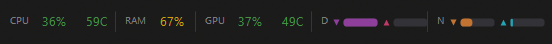

# SystemBar Indicator

[](https://github.com/coldneuro/SystemBarIndicator/actions/workflows/ci.yml)
[](LICENSE)
[](https://dotnet.microsoft.com/)
[](#requirements)

A small always-on-top system monitor that sits on the Windows 11 taskbar. It shows live
CPU, RAM, GPU, disk and network load plus CPU/GPU temperature, and expands into a
history-graph overlay when you click it.



Reading left to right: CPU load and temperature, RAM usage, GPU load and temperature, then
disk (`D`) and network (`N`). Each number lives in a fixed-width slot, so nothing shifts
sideways as values change, and the colour follows the load level. Disk and network are drawn
as a pair of bars rather than numbers — ▼ is read/download, ▲ is write/upload — smoothed and
auto-scaled to recent peaks.

## Features

- **CPU** — total load and temperature
- **RAM** — memory usage
- **GPU** — load and temperature (NVIDIA / AMD / Intel)
- **Disk** — read/write throughput as a smoothed dual bar
- **Network** — download/upload throughput as a smoothed dual bar
- **Graph overlay** — click the bar for eight history charts (CPU, CPU temp, RAM, GPU,
  GPU temp, disk R/W, net down, net up) over the last ~120 samples
- **Load colouring** — values change colour as load crosses the warning/critical thresholds
- **Always on top** — the bar keeps its z-order above the taskbar
- **Tray icon** — shows `CPU / RAM / GPU` in the tooltip, with a context menu
- **Remembered position** — drag the bar anywhere; it returns there after a restart, and
  is pulled back on screen if that spot no longer exists
- **Appearance settings** — theme, opacity, font scale, which sections to show, poll
  interval, °C/°F

## Requirements

- Windows 10 (build 19041+) or Windows 11
- [.NET 10 SDK](https://dotnet.microsoft.com/download) — to build; the published app needs
  only the .NET 10 desktop runtime
- Administrator rights — required to read hardware temperatures (the sensor driver is
  loaded into the kernel)
- [PawnIO](https://pawnio.eu) — **optional**, needed only for CPU temperature. See
  [Permissions and privacy](#permissions-and-privacy) below

## Install

### Option 1 — install script (recommended)

Publishes the app, then sets it up so a desktop shortcut launches it **elevated without a
UAC prompt every time**:

```powershell
git clone https://github.com/coldneuro/SystemBarIndicator.git
cd SystemBarIndicator
pwsh -File deploy/Install.ps1            # add -AutoStart to also start it at logon
```

You get exactly one UAC prompt during installation — for registering the scheduled task.
See [deploy/README.md](deploy/README.md) for how and why this works, and for uninstalling.

### Option 2 — run from source

```powershell
git clone https://github.com/coldneuro/SystemBarIndicator.git
cd SystemBarIndicator
dotnet run --project src/SystemBarIndicator.App
```

Started this way the app is **not** elevated, so temperatures will be unavailable —
everything else works.

## Usage

Right-click the tray icon:

| Item | Action |
|------|--------|
| **Graphs** | Open/close the history overlay (same as clicking the bar itself) |
| **Settings...** | Appearance settings window |
| **Reset Position** | Snap the bar back to the taskbar and forget the saved position |
| **Exit** | Quit |

**Moving it.** Drag the bar with the mouse — the position is remembered and restored on
the next start. Until you move it, the bar docks to the right edge of the taskbar and
follows it. If the saved spot becomes unreachable (monitor unplugged, resolution changed),
the bar is moved back into the visible area.

**Appearance** (`Settings...`, applied live):

- opacity, 30–100 %
- theme: dark, light, or a custom background colour
- font scale, 75–175 %
- which sections to show: CPU, CPU temp, RAM, GPU, GPU temp, disk, network
- poll interval: 0.5 / 1 / 2 / 5 s — smoothing rates are recalibrated with it
- temperature in °C or °F

## Configuration files

| Path | Contents |
|------|----------|
| `%LOCALAPPDATA%\SystemBarIndicator\settings.json` | Settings — safe to edit by hand; invalid values are silently replaced with valid ones |
| `%LOCALAPPDATA%\SystemBarIndicator\app.log` | Application log |

Writes are atomic (temp file + move), and a corrupt or missing settings file falls back to
defaults rather than failing to start.

## Permissions and privacy

This app reads hardware sensors, so it is worth being explicit about what it does:

- **No network access.** Nothing is sent anywhere; there is no telemetry, no update check,
  no analytics. Network counters are read locally from the OS.
- **Why administrator rights.** Temperatures come from
  [LibreHardwareMonitorLib](https://github.com/LibreHardwareMonitor/LibreHardwareMonitor),
  which reads CPU sensors through a kernel driver — that needs elevation. Load, RAM, disk
  and network figures do not; without elevation the app simply omits temperatures.
- **PawnIO instead of WinRing0.** LibreHardwareMonitor 0.9.5+ uses the signed
  [PawnIO](https://pawnio.eu) driver rather than WinRing0, which Microsoft Defender flags
  as vulnerable. PawnIO is installed separately and only once. Without it you lose CPU
  temperature — and importantly, the vulnerable driver is never loaded.
- **The bundled manifest is `asInvoker`**, not `requireAdministrator`. Elevation is
  arranged by the install script through a scheduled task, so nothing silently elevates
  itself.

## Tech stack

| Layer | Technology |
|-------|------------|
| Language | C# |
| UI | Windows Forms |
| Runtime | .NET 10 (`net10.0-windows`) |
| Drawing | GDI+ (`System.Drawing`) |
| CPU / RAM / disk / network | `PerformanceCounter`, `GlobalMemoryStatusEx`, `NetworkInterface` |
| Temperatures and GPU | [LibreHardwareMonitorLib](https://github.com/LibreHardwareMonitor/LibreHardwareMonitor) 0.9.6 |
| CPU sensor access | [PawnIO](https://pawnio.eu) — signed kernel driver |

## Project layout

```
src/
├── SystemBarIndicator.Core/       # net10.0 — platform-independent, unit-tested
│   ├── Models/                    #   SensorData, DataPoint, DataHistory
│   ├── Monitoring/                #   Load levels and thresholds
│   ├── Configuration/             #   AppSettings, SettingsStore, WindowPlacement, ColorCodec
│   └── Util/                      #   Formatting, Ema, AutoScale, SmoothingRates
└── SystemBarIndicator.App/        # net10.0-windows — WinForms UI + Windows sensors
    ├── Program.cs                 #   Entry point + MainForm (the taskbar bar)
    ├── GraphOverlay.cs            #   History graph overlay
    ├── SettingsForm.cs            #   Appearance settings, live preview
    ├── BarTheme.cs                #   Swappable GDI+ resources (theme, font scale)
    ├── Sensors/                   #   Cpu, Ram, Disk, Network, Hardware (LHM)
    └── Logging/Logger.cs          #   File logger

tests/SystemBarIndicator.Tests/    # net10.0 — xUnit, covers Core
deploy/                            # Install/Uninstall scripts (see deploy/README.md)
```

Anything that does not depend on WinForms or on the OS lives in `Core` and is unit-tested;
UI and OS access (P/Invoke, `PerformanceCounter`, LHM) live in `App`. `CLAUDE.md` holds the
detailed architecture notes — the non-obvious constraints behind the current design.

## Build and test

```powershell
dotnet build -c Release      # warnings are errors — see Directory.Build.props
dotnet test  -c Release      # xUnit
```

CI runs the same two commands on `windows-latest` for every push and pull request.

## Contributing

Bug reports and pull requests are welcome — see [CONTRIBUTING.md](CONTRIBUTING.md).
For anything security-related, see [SECURITY.md](SECURITY.md).

## License

[MIT](LICENSE)
